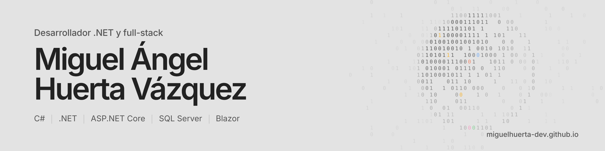
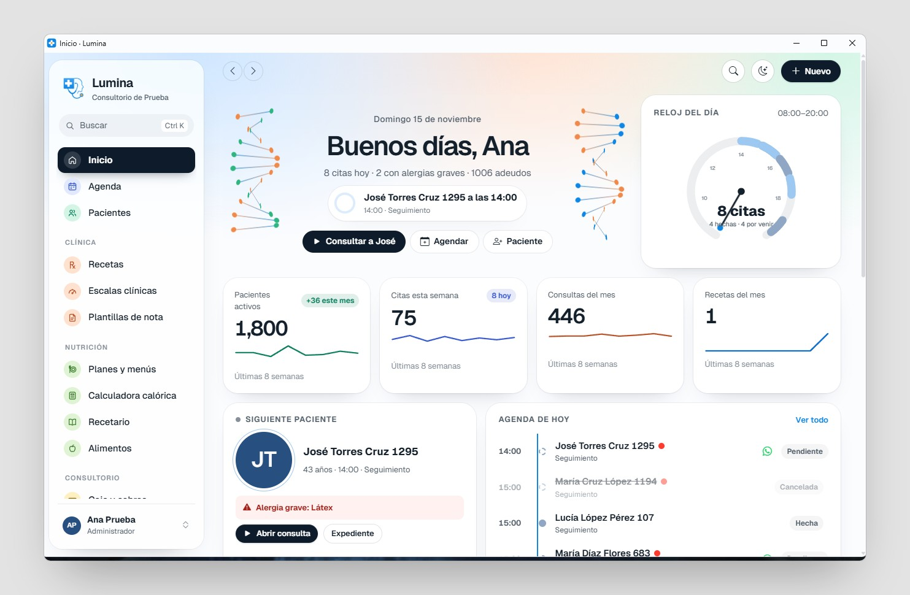
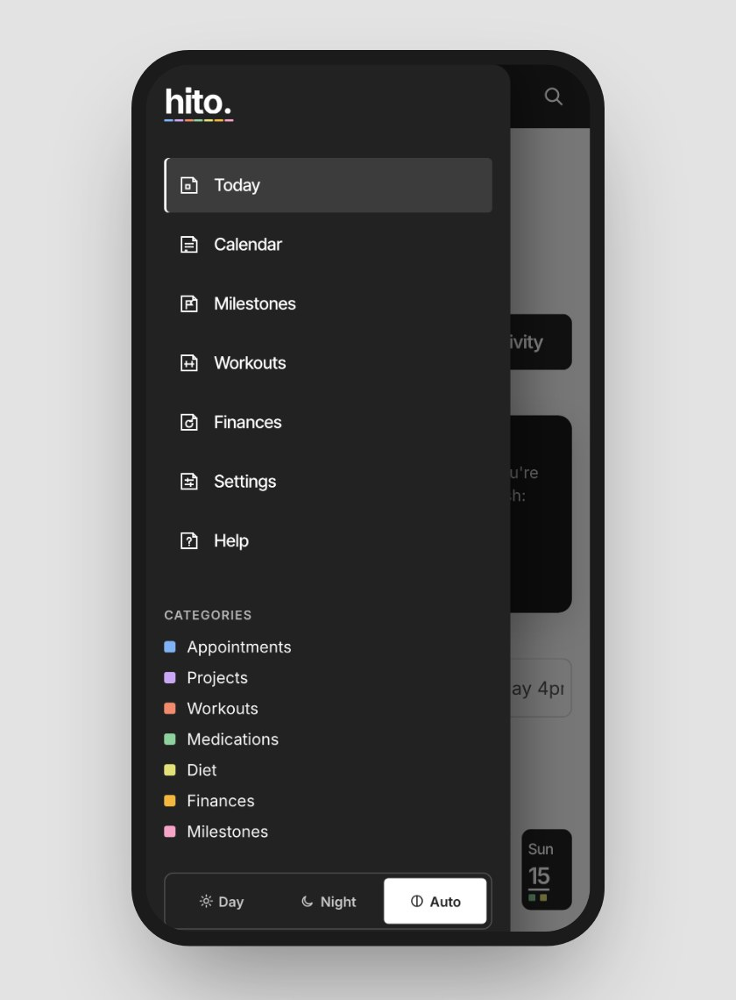
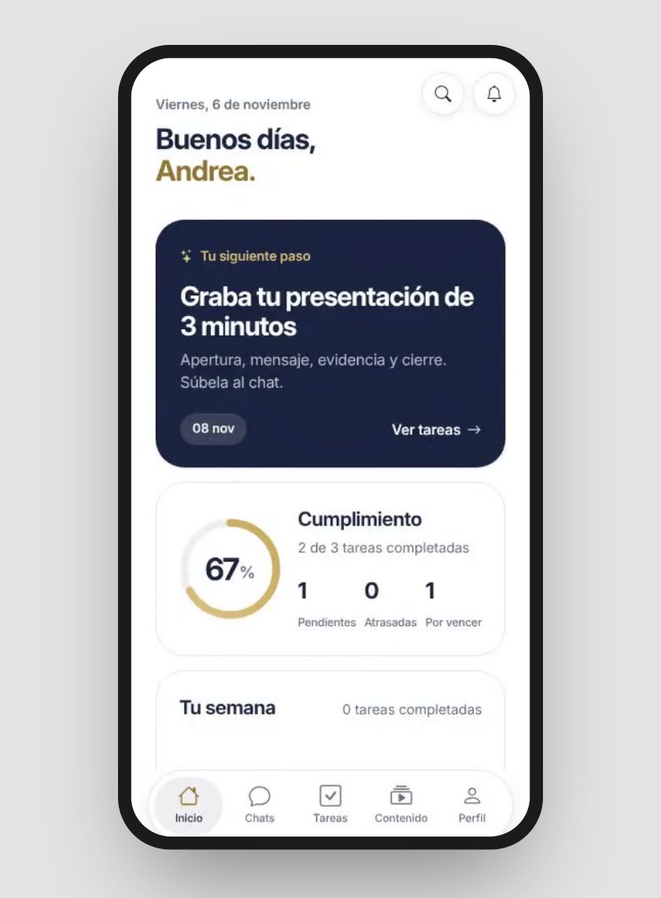

<picture>
  <source media="(prefers-color-scheme: dark)" srcset="assets/banner-dark.png">
  
</picture>

# Miguel Ángel Huerta Vázquez

**.NET and full-stack developer · Puebla, Mexico**

I build custom systems and cross-platform apps end to end: database, backend, interface and deployment.

 

 

## Featured projects

### Lumina · Clinical records system
`Lumina 3.0` · `In production at real medical practices` · `Windows and macOS`

Medical records, lab results, X-rays, prescriptions, scheduling and billing for medical and nutrition practices. It reads lab reports from a PDF or a photo, searches **14,484 ICD-10 codes offline**, includes a DICOM viewer, and keeps every patient record inside the practice.

`C# · ASP.NET Core (.NET 10) · EF Core · SQLite · Groq` · **[Watch the demo](https://miguelhuerta-dev.github.io/#lumina)**

 

<table>
<tr>
<td width="50%" valign="top">

### Hito
**Cross-platform personal planner** · `v0.6.1` · `Open source (MIT)`

Activities, milestones, workouts and personal finances on one timeline. Works offline, in English and Spanish, on Windows, macOS, Linux and Android. 38 unit tests.

`C# · .NET MAUI · Blazor Hybrid · xUnit`

**[Download](https://github.com/miguelhuerta-dev/hitodemo)** · **[Code](https://github.com/miguelhuerta-dev/hito)** · **[Demo](https://miguelhuerta-dev.github.io/#hito)**

</td>
<td width="50%" valign="top">

### Mentoring CRM
**Built for an executive mentor** · `Sold` · `Solo developer`

A client pipeline with one dashboard for the mentor and one for each mentee, real-time chat, a content library and session scheduling. Installable as a PWA.

`ASP.NET Core MVC · SQL Server · SignalR · PWA`

**[Demo](https://miguelhuerta-dev.github.io/#mentoring)**

</td>
</tr>
</table>

 

## Stack

`C#` `ASP.NET Core` `.NET MAUI` `Blazor` `Entity Framework Core` `SQL Server` `SQLite` `SignalR` `xUnit`

 

`Windows` `macOS` `Linux` `Android`

 

`HTML` `CSS` `JavaScript` `Bootstrap` `Python` `Git` `GitHub Actions` `Playwright` `Figma` `Godot` `Blender` `three.js`

 

## Contributions

 

## Also building

- **CLAMOR** (working title): a survival horror game set in Castile in 1580, in development. `Godot 4 · Blender · three.js prototype`

 

## Contact

Have a job opening or a project? I reply within 24 hours, in English or Spanish.

 

 

Designed by Miguel Huerta

<!-- El retorno del hijo pródigo -->
